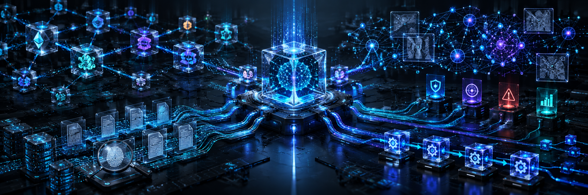

<!-- readme-pro-header:start -->

  
   
  <h1>SWAT NeuralBus for n8n</h1>
  <strong>SWAT NeuralBus blockchain investigations, evidence and forensic graphs for n8n</strong>
   
   
  
  
  
  
  
  
    
  <a href="https://neuralbus.norug.es">Website</a> &nbsp;&middot;&nbsp; <a href="https://github.com/norug-es/n8n-nodes-swat-neuralbus/issues">Issues</a> &nbsp;&middot;&nbsp; <a href="https://github.com/norug-es/n8n-nodes-swat-neuralbus">Source</a>

<!-- readme-pro-header:end -->

### Blockchain Intelligence & Forensic Automation

**Transformamos datos blockchain en inteligencia accionable. Conectamos investigaciones, evidencias y automatización en un único ecosistema.**

SWAT NeuralBus for n8n es una integración tecnológica desarrollada por **NORUG.es** que permite incorporar capacidades de inteligencia blockchain, investigación forense digital, análisis de riesgos y gestión de evidencias directamente en los flujos de automatización de n8n.

Nuestra visión es democratizar el acceso a herramientas avanzadas de investigación blockchain, facilitando que analistas, investigadores, profesionales de ciberseguridad, equipos de cumplimiento normativo y empresas tecnológicas puedan construir procesos de investigación reproducibles sin desarrollar integraciones complejas.

## De una dirección blockchain a una investigación

SWAT NeuralBus actúa como una capa inteligente de orquestación que conecta motores de análisis blockchain, sensores especializados, inteligencia de riesgos, registros de evidencias y herramientas de visualización forense.

A través de n8n, los usuarios podrán diseñar workflows capaces de consultar direcciones y transacciones, analizar relaciones, organizar hallazgos, producir grafos interactivos y coordinar procesos de investigación con servicios externos.

## Capacidades del ecosistema

**Blockchain Intelligence:** análisis automatizado de direcciones, wallets, transacciones y entidades en redes compatibles.

**Forensic Investigation:** gestión de expedientes, recopilación de evidencias y consulta de resultados de investigación.

**Graph Intelligence:** generación de grafos forenses, exploración de relaciones y visualización de conexiones entre entidades blockchain.

**Risk Intelligence:** ejecución de sensores especializados e interpretación de indicadores de riesgo con información de procedencia y cobertura.

**Evidence & Proof:** integridad criptográfica, consulta de evidencias y verificación de pruebas digitales.

**AI & MCP Integration:** conexión con agentes de inteligencia artificial y herramientas compatibles con Model Context Protocol.

**Monitoring & Alerts — Roadmap:** automatización de alertas y supervisión continua de actividades relevantes.

## Diseñado para investigaciones verificables

En SWAT consideramos que un análisis profesional debe permitir distinguir los hechos observados de las inferencias.

Por eso, nuestro enfoque prioriza la trazabilidad de fuentes, la integridad de los registros, los estados de verificación, la privacidad y la reproducción de resultados.

Una puntuación de riesgo no constituye por sí sola una prueba de actividad ilícita. Una evidencia íntegra tampoco garantiza que todas sus interpretaciones sean correctas.

La tecnología debe ayudar al investigador a construir conclusiones fundamentadas, no sustituir su criterio profesional.

## Automatización sin fronteras

Al integrarse con n8n, SWAT NeuralBus permite conectar sus capacidades a sistemas de gestión empresarial, plataformas de seguridad, agentes de IA, notificaciones, bases de datos y otros servicios mediante workflows personalizables.

Nuestra propuesta combina tres elementos: **inteligencia blockchain, automatización de procesos y evidencia digital verificable.**

## Arquitectura abierta y extensible

El proyecto utiliza una integración nativa para n8n construida sobre las interfaces REST de SWAT NeuralBus, con la posibilidad de aprovechar herramientas MCP para capacidades avanzadas.

Su arquitectura está orientada a facilitar la evolución independiente del motor analítico y de sus integraciones.

## Estado del proyecto

**Versión inicial: v0.1.0 — fase de desarrollo y pruebas.**

La primera etapa se centra en conectar las capacidades ya documentadas de NeuralBus: análisis blockchain, expedientes, evidencias, pruebas y grafos forenses.

Las funcionalidades futuras se incorporarán conforme superen sus validaciones técnicas, de seguridad y despliegue.

## Nuestra misión

**Hacer que la investigación blockchain profesional sea más accesible, automatizable, transparente y verificable.**

No queremos construir simplemente otro nodo de n8n.

Queremos construir una puerta de acceso a un ecosistema de inteligencia forense que permita investigar mejor, automatizar con criterio y convertir datos dispersos en conocimiento útil.

**SWAT NeuralBus — Intelligence in Motion.**

Developed by **NORUG.es**

https://norug.es

https://neuralbus.norug.es
